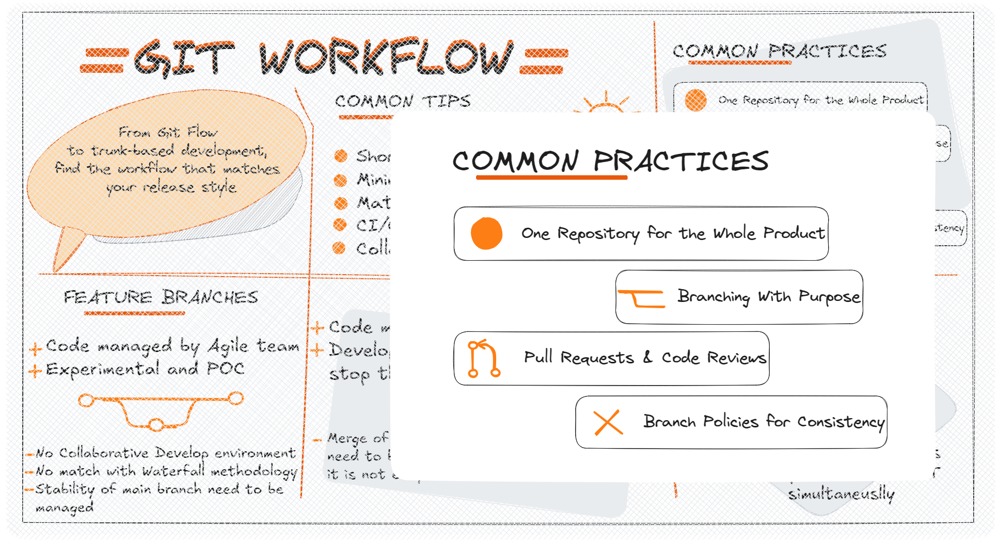

When I first started using Git, I thought it was just about committing changes and pushing them somewhere "safe". But over the years, I’ve learned that **how** you use Git is just as important as using it at all.

A **Git workflow** isn’t just a fancy term — it’s a set of guidelines and habits that help teams (and solo devs!) keep their work organized, collaborative, and less prone to “merge hell.”

This series is my attempt to share the practices I’ve found most effective. These aren’t the only ways to work with Git, but they’re the ones that keep my projects clean, my teammates happy, and my future self grateful.

Let’s start with the core habits I follow in almost every project.

---

## 1. One Repository for the Whole Product

I prefer to keep everything for a product in a **single repository**.

Why?

* All the code lives in one place—no hunting through multiple repos.
* Easier to track changes across the whole system.
* Dependencies are managed in one ecosystem.

Of course, there are cases for splitting repos (microservices, for example), but for most of my projects, the single-repo approach keeps things simpler and more transparent.

---

## 2. Branching With Purpose

Git workflows typically involve branching to separate different lines of development. This allows developers to work on different features or fixes simultaneously without interfering with each other's code.

Another common practice is to use branches for different stages of development. For example, a development branch can be used for new features, while a stable branch is used for bug fixes and releases. This allows developers to work on different parts of the codebase without affecting the stability of the main product.

---

## 3. Pull Requests & Code Reviews

Git workflows often involve peer code reviews to ensure that changes are of high quality and meet the team's standards. This can be done through pull requests, where developers request reviews before merging their changes.

Every change—big or small—goes through a **pull request (PR)**.

The benefits are huge:

* **Quality checks** from other eyes on the code.
* **Shared knowledge** so no feature is “owned” by just one person.
* A clear **history of discussions** around a change.

Even when I’m the only developer on a project, I still use PRs as a form of self-review. It’s amazing how many little mistakes I catch by forcing myself to write a description of what I’ve done.

---

## 4. Branch Policies for Consistency

Branch policies are the silent guardians of a repo. They enforce the rules without relying on human memory.

Some of my favorites:

* Require at least **two reviewers** before merging.
* Run **automated tests** before approving.
* Block merges if the build fails.
* Restrict direct pushes to `main` or `release` branches.

This automation keeps the quality bar high and prevents “just this once” mistakes that can break production.

---

## 5. Feature Flags for Controlled Rollouts

Not every feature needs to be an all-or-nothing launch. **Feature flags** let me toggle functionality without redeploying.

They help with:

* **Gradual rollouts** (start with 5% of users, then expand).
* **A/B testing** to compare different implementations.
* **Instant rollbacks** if a new feature causes trouble.

Of course, feature flags need discipline—too many untracked flags can turn a codebase into a maze. But used carefully, they’re a superpower for safer releases.

---

### Wrapping Up Part 1

These practices—single repo, structured branching, PR reviews, branch policies, and feature flags—form the foundation of how I work with Git.

These habits aren’t just about Git; they’re about creating a culture of quality and collaboration. They help me and my teams stay organized, focused, and ready to tackle whatever comes next. They are indipendent of the tools we use, the team size, project management methodologies, or the project complexity.

## References

* [Why Git](https://www.git-tower.com/learn/git/ebook/en/desktop-gui/appendix/why-git)
* [Pull Request](https://www.git-tower.com/learn/git/ebook/en/desktop-gui/advanced-topics/pull-requests)
* [Comparing Workflos](https://www.atlassian.com/git/tutorials/comparing-workflows)

---

*Some bytes of this blog post were co-written with AI. The brain behind it is still very much human.*
