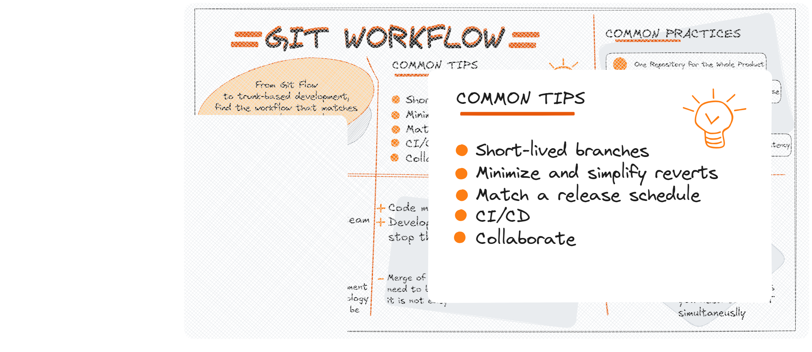

In [Part 1](../my-gitflow-1-common/index.md), I shared the core practices that form the foundation of my Git workflow, focusing on structure, stability, and collaboration. This second part moves from the fundamentals to more practical advice, aimed at refining daily work and ensuring the workflow adapts naturally to both the team’s habits and the business’s release rhythms.

There is no universal Git workflow that works for everyone. The right approach must enhance productivity without creating unnecessary friction, and ideally it should align with the way a team communicates, makes decisions, and ships software. A company’s release schedule, for example, should be reflected in how branches and tags are used, and teams that rely heavily on task tracking or project management tools may find it valuable to name branches in a way that directly corresponds to the tasks they are currently working on.

---

## Short-lived branches

The longer a branch remains separate from the production branch, the greater the likelihood of encountering merge conflicts, integration issues, and deployment difficulties. By ensuring that branches are merged back into the main branch as soon as their purpose is fulfilled, and by keeping the number of active branches to a minimum, the overall health of the repository is preserved. Once a branch has been merged, deleting it promptly not only keeps the repository clean but also reduces the cognitive load for anyone navigating the project’s history.

---

## Minimize and simplify reverts

Although a well-structured workflow can proactively prevent problematic merges—often through automated testing, code reviews, and branch protection rules—mistakes can still occur. When they do, it is important that the workflow allows changes to be reverted quickly and cleanly, without causing disruptions for other developers working on parallel tasks. This means having both preventative measures in place and a reliable safety net that enables the team to respond effectively when something goes wrong.

---

## Match a release schedule

The structure of a Git workflow should mirror the rhythm of a project’s release cycle. When software is deployed multiple times a day, it becomes essential to keep the main branch permanently stable and ready for production. Conversely, when releases are less frequent, it can be advantageous to use Git tags to label specific commits as version points, creating clear markers in the project’s history that simplify tracking, auditing, and rolling back when necessary.

---

## CI/CD

To sustain a rapid release cadence, it is crucial to optimize build and test execution times in continuous integration and delivery pipelines. This often involves making use of caching layers to avoid repeating expensive computations for unchanged code, as well as structuring builds so that tasks can run in parallel where possible. The result is a faster feedback loop, which not only accelerates the pace of delivery but also reduces the risk of delays caused by bottlenecks in the release process.

---

## Collaborate

Ultimately, Git is not just a technical tool but also a collaborative environment in which code quality and shared understanding are built through interaction. Asking for feedback during the review process, being open to constructive suggestions, and offering detailed explanations of the reasoning behind changes all contribute to a culture in which the workflow becomes more than a process—it becomes a conversation. This culture of collaboration ensures that the benefits of a strong workflow extend beyond the code itself, fostering trust and shared responsibility within the team.

## References

- [Git Best Practices](https://www.git-tower.com/learn/git/ebook/en/desktop-gui/appendix/best-practices)
- 
---

*Some bytes of this blog post were co-written with AI. The brain behind it is still very much human.*