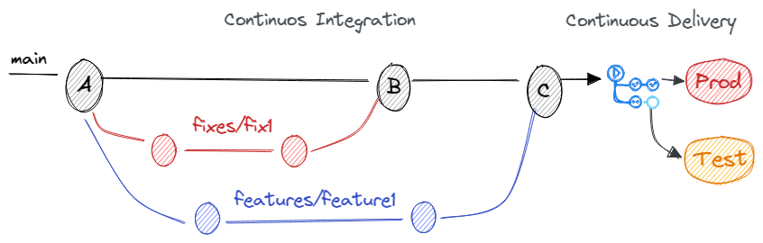

The **Feature Branch Workflow** is built on one simple principle: all new development should happen in its own dedicated branch rather than directly on the `main` branch. By isolating work, developers can collaborate freely without breaking production-ready code. This keeps `main` clean, stable, and always deployable—an approach that fits perfectly with continuous integration and continuous delivery (CI/CD) environments.

---

## Features Flow

Here’s how a typical feature development cycle looks:

1. **Create a feature branch** from `main` using a clear naming convention such as `feature/<short-description>`.
2. **Develop and push changes** regularly to the feature branch, keeping commits focused and atomic.
3. **Open a pull request** once the feature is complete and ready for review. This invites feedback, suggestions, and validation from other developers.
4. **Review and approve the PR**, making adjustments if needed before merging.
5. **Merge into `main`** once approved, keeping history clean and traceable.
6. **Trigger the CI/CD pipeline** to build and deploy changes to test environments and eventually to production.

---

## Fixes Flow

Bug fixes follow almost the same pattern as features, with minor adjustments:

1. **Create a fix branch** from `main`, typically named `fix/<short-description>` for clarity.
2. **Work on the fix**, committing changes frequently and pushing to the branch.
3. **Open a pull request** for review once the issue is resolved.
4. **Review, approve, and merge** the fix into `main`.
5. **Deploy via CI/CD**, ensuring the patch is tested and released quickly.

---

## Use Cases

Feature branching is ideal for:

* **Agile teams** working in short sprints and delivering incremental improvements.
* **Proof-of-concept or experimental work** where features might be abandoned before release.
* **High-collaboration environments** where code reviews are an essential part of the workflow.
* **Situations where rollback safety is critical**, since features are isolated from production until approved.

---

## CONs

Some trade-offs to consider with feature branching:

* **Less collaborative real-time coding**, since work is isolated in branches.
* **Not aligned with Waterfall** methodologies that prefer large, planned releases.
* **Requires strong stability controls**—automated tests, branch protection, and diligent reviews—to keep `main` production-ready.

---

## References

- [Feature Branch Workflow](https://www.atlassian.com/git/tutorials/comparing-workflows/feature-branch-workflow)

---

*Some bytes of this blog post were co-written with AI. The brain behind it is still very much human.*