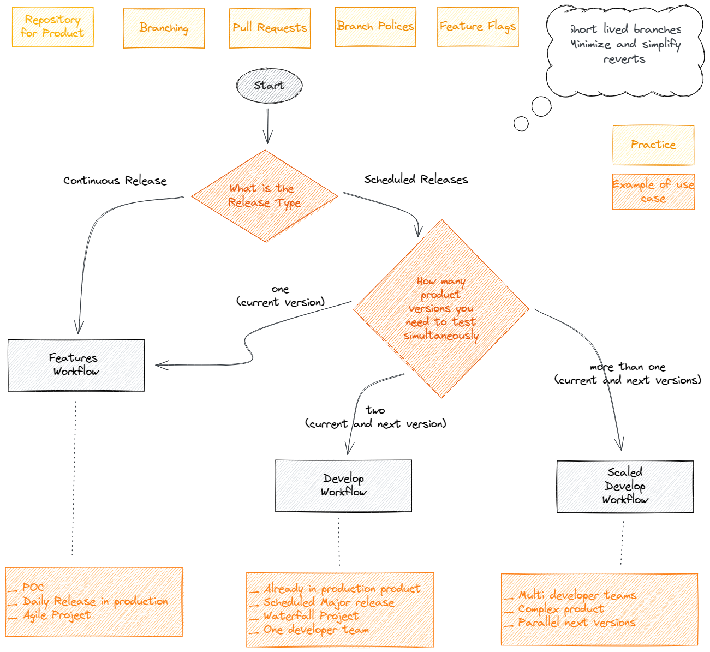

Got it — I’ll base **Part 5** of your series on *Choosing the Right Workflow* using the ideas from your attached diagram.

---

# My Git Workflow – Part 5: Choosing the Right Workflow

When it comes to Git branching strategies, there’s no universal “best” choice. The right workflow depends on your product’s release needs, your team’s collaboration style, and how you balance speed with stability. The goal is to pick a model that minimizes friction while supporting the way your team actually works.

---

## Start with the End in Mind

Before committing to a workflow, ask yourself:

* **How often do we release?** If your team deploys multiple times a day, a lightweight trunk-based approach may be ideal. If releases are scheduled weeks apart, Gitflow or a similar model could offer more structure.
* **How large is the team?** Larger teams often benefit from more explicit branch roles and review gates to prevent conflicts and maintain quality.
* **How tolerant are we of risk?** A workflow with long-lived branches may give more control, but it also increases the risk of divergence.

---

## When to Choose Feature Branching

Feature Branching is a good fit if:

* Your team wants to isolate work until it’s production-ready.
* You rely heavily on pull requests and peer reviews.
* Your product requires frequent, small updates with minimal coordination overhead.

It’s less suited for teams needing highly collaborative real-time coding or for Waterfall-style, tightly scheduled releases.

---

## When to Choose Gitflow (Develop Workflow)

Gitflow shines when:

* Releases are planned and coordinated in advance.
* Complex features need to be developed in parallel without blocking maintenance.
* You require multiple testing environments or staged deployments.

Its added structure and long-lived branches are helpful in these cases but require disciplined branch alignment and automated processes to avoid merge headaches.

---

## Scaling Considerations

When scaling up—whether in team size, product complexity, or release cadence—the key is automation. This includes:

* Automatically aligning `develop` branches with `main`.
* Automating CI/CD to ensure branches remain deployable.
* Using branch protection rules to enforce review and testing standards.

Without automation, the overhead of managing many branches and merges will slow development to a crawl.

---

## Final Thoughts

Choosing a Git workflow isn’t about following trends—it’s about adopting a model that amplifies your team’s strengths and minimizes your pain points. Start with the simplest model that meets your needs, then evolve it as your team and product grow. And remember: a workflow is only as good as the discipline and communication that support it.

---

*Some bytes of this blog post were co-written with AI. The brain behind it is still very much human.*